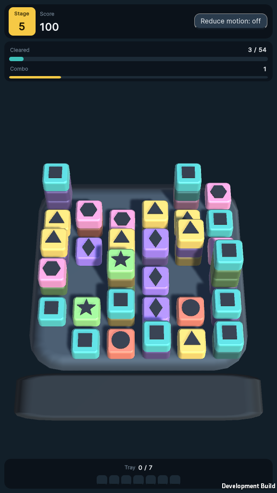
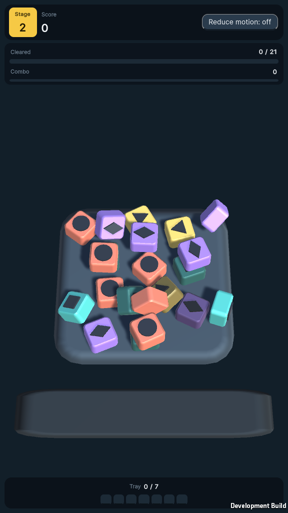

# Unity-Arcade-Companion

Work in progress. This repo holds two Unity projects and their shared docs.

## Pulse Arena (`PulseArenaGame/`)

An original triple-match game. Tiles go to a tray, and three of a kind clear. The MVP runs in Unity 6000.4.0f1, in portrait and landscape, with five stages, Retry, Next stage and a Reduce Motion option. A physics-mode prototype sits beside it and is not shipped.

Bright tiles have nothing resting on them and can be tapped. Dim tiles are covered and blocked.

## Status

- Checked: standalone Development builds and Unity Play Mode checks, a human playtest of stages 1 to 4, and the Core rules, tested with `dotnet test` in `PulseArenaGame/Harness`.
- Not checked yet: Android and touch on a device, frame time on a phone, and whether physics mode feels right.
- Per-item results are in `PulseArenaGame/UNITY_VERIFICATION_CHECKLIST.md`. Decisions and the board are in `docs/DECISIONS.md` and `docs/BOARD.md`.

## Layout

- `PulseArenaGame/`: the Pulse Arena Unity project and its README.
- `UnityLearningCompanion/`: a separate companion package, with its own README.
- `docs/`: decisions, the board and evidence.
